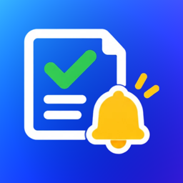
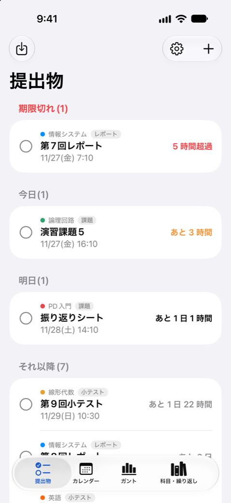
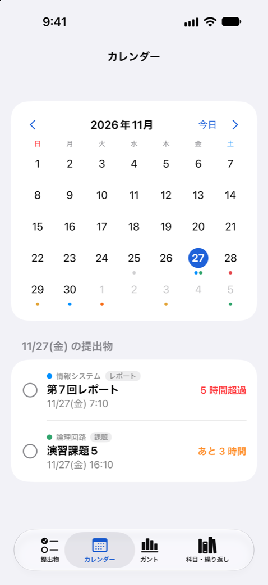
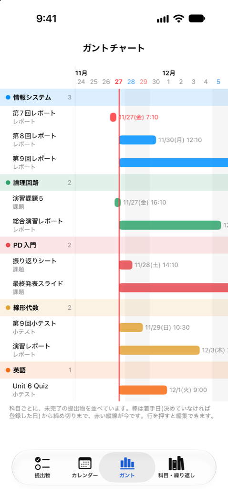
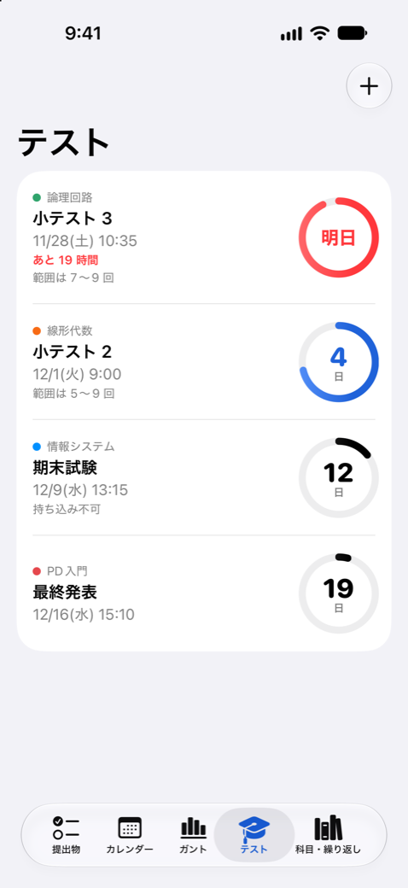
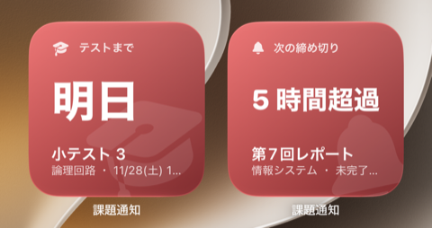
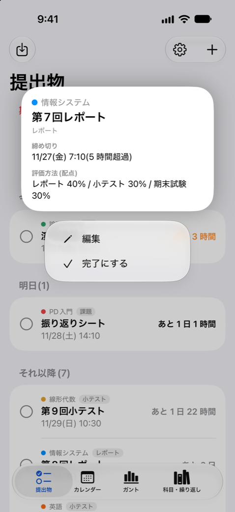
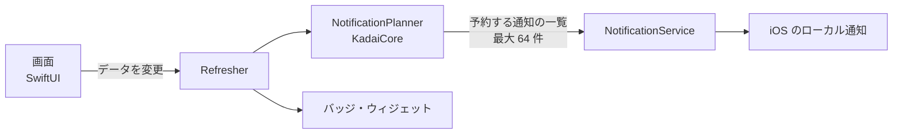

<p align="center">
  
</p>

# KadaiNotify(課題通知)

大学の提出物(課題・レポート・小テスト)の締め切りを、iPhone の通知で知らせるアプリです。
完了チェックを付けるまで毎晩思い出させてくれるので、提出を落としにくくなります。

サーバーもアカウントも使わず、データはすべて iPhone の中に保存します。自分で使うために作った個人用のアプリです。

| 提出物の一覧 | カレンダー | ガントチャート |
|:---:|:---:|:---:|
|  |  |  |

| テストまでの日数 | ホーム画面ウィジェット | 長押しで評価方法を確認 |
|:---:|:---:|:---:|
|  |  |  |

画面の画像は、すべて架空のサンプルデータです。

## 目次

- [なぜ作ったか](#なぜ作ったか)
- [できること](#できること)
- [設計のポイント](#設計のポイント)
- [使っている技術](#使っている技術)
- [動かし方](#動かし方)
- [使い方](#使い方)
- [テスト](#テスト)
- [フォルダ構成](#フォルダ構成)
- [困ったとき](#困ったとき)
- [制限と今後](#制限と今後)
- [開発について](#開発について)

## なぜ作ったか

大学の学生ポータルには提出物の一覧が載りますが、プッシュ通知が来ないので、自分で見に行かないと締め切りに気づけません。
後期になって提出物が増え、落としそうになったのがきっかけです。

目標は 3 つです。

1. 締め切りを **iPhone の通知で確実に知らせる**。
2. 終わるまで **しつこく思い出させる**。
3. ポータルで見つけた提出物を、**手打ちせずに**まとめて登録できる。

詳しい仕様は [docs/REQUIREMENTS.md](docs/REQUIREMENTS.md)(要件定義書)にまとめています。

## できること

### 通知

- 締め切りの **3 日前・1 日前の 21:00** に通知。タイミングは「全体 → 科目 → 課題」の順に上書きできます。
- 未完了の提出物がある限り、**毎晩 21:00 にまとめて通知**します。期限切れも、完了にするまで含め続けます。
- 今日か明日が締め切りの朝だけ、**朝のまとめ通知**(「今日締め切り 2 件・明日 1 件」)が届きます。
- 通知を長押しして、**その場で「完了にする」「1 時間後にもう一度」**を選べます。アプリを開く必要はありません。
- **着手日**を決めておくと、取りかかる日時にも通知します。
- テストは、**7 日前・3 日前・前日**に知らせます。
- アプリのアイコンに、未完了の件数を数字で出します。

### 登録と取り込み

- 科目は一覧から選ぶだけ。種類(課題・レポート・小テストなど)は課題名から自動で選ばれます。
- 重要さを表す**ランク**(S・A・B・C)を付けられます。
- 「毎週木曜 17:00 締め切り」のような**繰り返しの提出物**を登録できます。
- 決まった形式のテキストを貼り付けて、**まとめて登録**できます。登録済みのものは自動で見分けます。
- 貼り付けが使えないときは、**Mac からケーブルで直接送る**こともできます。

### 見る

- **一覧**: 期限切れ・今日・明日・それ以降に分けて、締め切りが近い順に並べます。
- **テスト**: 登録したテストまで「あと ○ 日」を大きく表示します。日付で数えるので、朝でも夜でも同じ日数です。
- **カレンダー**: 締め切りのある日に、科目の色の点が付きます。
- **ガントチャート**: 科目ごとに期間を横棒で表します。課題がない科目も並ぶので、いま手が空いている科目が分かります。
- **長押し**: 提出物を長押しすると、締め切り・メモと一緒に、その科目の**評価方法(配点)**を確認できます。
- **ホーム画面ウィジェット**: 「次の締め切り」と「テストまでの日数」の 2 種類を、アプリを開かずに確認できます。

## 設計のポイント

### サーバーなしで「しつこく思い出させる」

通知は iPhone の中だけで予約する**ローカル通知**を使っています。サーバーが要らない代わりに、iOS には「1 つのアプリが予約できる通知は 64 件まで」という上限があります。

そこで、通知の種類ごとに枠を決めて、近いものから順に予約しています。

| 通知 | 枠 |
|---|---|
| 毎晩のまとめ通知 | 14 晩分 |
| 朝のまとめ通知 | 最大 7 日分(締め切りが近い朝だけ) |
| 締め切り前の通知・着手日の通知・テストの通知 | 残りの枠(42〜49 件) |
| 「1 時間後にもう一度」の再通知 | 最大 5 件 |
| 署名期限のお知らせ | 1 件 |

予約のし直しは、アプリを開いたときやデータを変えたときに「全部消して作り直す」方式にしています。作りが単純で、予約がずれることがありません。

### 計算を画面から切り離してテストする

通知の日時の計算、取り込みテキストの読み取り、カレンダーやガントチャートの位置の計算は、画面にも iOS の通知機能にも依存しない形で `Packages/KadaiCore` にまとめています。



こうすると、「木曜 17:00 締め切りなら、月曜 21:00 と水曜 21:00 に鳴る」といった動きを、iPhone を使わずにテストで確かめられます。テストは 74 件あります。

### 取り込みは、人が確認できるテキストで

学生ポータルの提出物は、Mac の Claude in Chrome に読み取ってもらい、次の形式のテキストにします。

```
#kadai v1
情報システム | 第8回レポート | 2026-12-03 17:00 | A4 2枚
PD入門 | 振り返りシート | 2026-12-05 |
```

アプリはこれを読み取り、登録前に必ず確認画面を出します。AI の読み取りがずれることがあるので、人が目で見て直せるようにするためです。
ポータルのパスワードをアプリに持たせず、自動ログインもしない作りにしています。

### あとから項目を足しても、データが消えないように

種類・ランク・着手日やテストの登録は、あとから足したものです。項目はどれも「なくてもよい」形で定義しているので、古いデータをそのまま開けます。古い版で作ったデータを新しい版で開けることは、シミュレーターで確かめています。

### 公開リポジトリに個人の情報を入れない

- 実際の提出物のデータは、Git の管理対象外の `build/` フォルダにだけ置きます。
- 署名に使う Team の ID は、コマンドの引数で渡せるようにして、プロジェクトのファイルには書き込みません。

## 使っている技術

追加のライブラリは使わず、Apple 標準の仕組みだけで作っています。

| 技術 | 用途 |
|---|---|
| Swift 5 / SwiftUI | 画面 |
| SwiftData | iPhone の中へのデータ保存 |
| UserNotifications | ローカル通知、通知のボタン |
| WidgetKit | ホーム画面ウィジェット |
| Swift Package / XCTest | 計算部分(KadaiCore)とそのテスト |

対応: iOS 18 以上。Xcode 16 以上(Xcode 27.2 で動作を確認)。

## 動かし方

### 必要なもの

| もの | 説明 |
|---|---|
| Mac | macOS 15 以降 |
| Xcode | Mac の App Store から無料で入れられます(16 以降) |
| iPhone | iOS 18 以降。実機で使う場合だけ必要です |
| Apple ID | ふだんの Apple ID で構いません。有料の Developer Program は不要です |

### コードを手元に持ってくる

```bash
git clone https://github.com/kotakota914/kadai-notify.git
```

### シミュレーターで試す(いちばん手軽)

iPhone がなくても、Mac の中の仮想 iPhone(iOS シミュレーター)で動かせます。署名も不要です。

```bash
scripts/run-simulator.sh --sample
```

ビルドして起動し、サンプルの提出物を入れた画面を `build/simulator.png` に保存します。`--sample` を外すと、空の状態で起動します。

### iPhone に入れる

最初の 1 回だけ、署名の設定が必要です。

> **署名とは:** 「このアプリは誰が作ったか」を Apple の仕組みで証明すること。iPhone は署名のないアプリを動かしません。

1. `KadaiNotify.xcodeproj` を Xcode で開く。
2. **Xcode > Settings… > Accounts** で、自分の Apple ID を追加する。
3. 左の一覧の一番上「KadaiNotify」を選び、**TARGETS** の `KadaiNotify` → **Signing & Capabilities** を開く。
   - 「Automatically manage signing」にチェックを入れる。
   - **Team** で「(自分の名前) (Personal Team)」を選ぶ。
4. `KadaiNotifyWidgetExtension` でも、同じように Team を選ぶ。
5. iPhone を USB ケーブルでつなぎ、「このコンピュータを信頼しますか?」で**信頼**を押す。
6. iPhone の **設定 > プライバシーとセキュリティ > デベロッパモード** をオンにして再起動する。
7. Xcode の上部で自分の iPhone を選び、**▶** を押す。
8. 「信頼されていないデベロッパ」と出たら、**設定 > 一般 > VPN とデバイス管理** で信頼して、もう一度 ▶ を押す。
9. アプリが開いたら、通知を**許可**する。

Team を選ぶと、`project.pbxproj` に自分の Team の ID が書き込まれます。公開リポジトリには、この変更をコミットしないでください。

<details>
<summary>コマンドで入れる(Team の ID をファイルに書かない方法)</summary>

Xcode で一度プロジェクトを開いて署名を通したあとは、コマンドだけでビルドと転送ができます。`TEAMID` と `DEVICE` は自分のものに置き換えます。

```bash
xcodebuild -project KadaiNotify.xcodeproj -scheme KadaiNotify \
  -destination 'id=DEVICE' -derivedDataPath build/DerivedData \
  -allowProvisioningUpdates DEVELOPMENT_TEAM=TEAMID build
```

```bash
xcrun devicectl device install app --device DEVICE \
  build/DerivedData/Build/Products/Debug-iphoneos/KadaiNotify.app
```

`DEVICE` は `xcrun devicectl list devices` で確認できます。

</details>

### 無料の Apple ID で使うときの注意

- 入れてから **7 日でアプリが開けなくなります**。期限の前日の夜に、アプリが通知で知らせます。
- 入れ直しは、Xcode で ▶ を押すだけです。**登録した提出物は消えません**。
- **アプリを iPhone から削除すると、データはすべて消えます**。
- 1 台の iPhone に入れられる自作アプリは **3 個まで**です。

## 使い方

### 提出物を追加する

「提出物」タブの右上の **+** を押し、科目を選んで課題名と締め切りを入れます。
種類は課題名から自動で選ばれ、ランクと着手日は必要なときだけ決めます。

完了にするには、行の左の丸を押すか、右にスワイプします。左にスワイプすると削除できます。

### テストを登録する

「テスト」タブの右上の **+** を押し、テスト名と日時を入れます。科目とメモ(範囲や持ち込みなど)は任意です。
日時を過ぎたテストは、自動で「終わったテスト」に移ります。

### 学生ポータルの提出物をまとめて取り込む

1. アプリの「提出物」タブ右上の歯車 →「Claude への頼み方をコピー」を押す(内容は[要件定義書の 7.4](docs/REQUIREMENTS.md)と同じです)。
2. Mac の Chrome で学生ポータルを開き、Claude in Chrome にその文を渡す。
3. 出てきた `#kadai v1` で始まるテキストをコピーする。
4. iPhone のアプリで、左上の取り込みボタン →「ペースト」を押す。
5. 確認画面で内容を見て、右上の「○ 件を登録」を押す。

Mac でコピーしたものを iPhone で貼り付けられるのは、Apple の**ユニバーサルクリップボード**の機能です。両方で同じ Apple ID にサインインし、Bluetooth・Wi-Fi・Handoff をオンにしておきます。

### 貼り付けが使えないとき: ケーブルで直接送る

1. 取り込みテキストを `build/kadai-import.txt` に保存する。
2. iPhone を Mac にケーブルでつなぎ、ロックを解除する。
3. 次のコマンドを実行する。

```bash
scripts/send-to-iphone.sh
```

iPhone でアプリが開き、貼り付けたときと同じ確認画面が出ます。Xcode から入れたアプリ(開発用の署名)でだけ使えます。

### 取り込みテキストの書き方

1 行目は必ず `#kadai v1` にします。2 行目以降は、次の 4 種類の行を書けます。

| 行 | 意味 |
|---|---|
| `科目 \| 課題名 \| 締め切り \| メモ` | 提出物を 1 件登録します。締め切りは `2026-12-03 17:00` か `2026-12-03`。メモは省略できます |
| `#exam 科目 \| テスト名 \| 日時 \| メモ` | テストを登録します。「テスト」タブに並び、残り日数を数えます |
| `#subject 科目名` | 科目だけを登録します。追加画面の一覧から選べるようになります |
| `#grading 科目名 \| 評価方法` | 科目の評価方法(配点)を登録します。提出物を長押しすると見られます |

時刻のない締め切りは、8:50(1 限の前)として登録します。設定で変えられます。

```
#kadai v1
#subject 線形代数
#grading 情報システム | レポート 40% / 小テスト 30% / 期末試験 30%
#exam 線形代数 | 期末試験 | 2026-12-10 09:00 | 範囲は全部
情報システム | 第8回レポート | 2026-12-03 17:00 | A4 2枚
```

### ウィジェットを置く

ホーム画面の何もない所を長押し → 左上のボタン →「ウィジェットを追加」→「課題通知」を選びます。
横にスワイプすると、「次の締め切り」と「テストまでの日数」をそれぞれ小・中のサイズで選べます。

## テスト

```bash
cd Packages/KadaiCore && swift test
```

通知の計算、取り込みの読み取り、繰り返し、種類の推測、テストまでの残り日数、カレンダーとガントチャートの計算を、74 件のテストで確かめています。
テストは日本時間に固定したカレンダーを使うので、実行する環境の設定に左右されません。

### 動作確認の状況

| 項目 | 状況 |
|---|---|
| 一覧・カレンダー・ガントチャート・テスト・追加画面・長押しのカード | シミュレーターで確認済み |
| ウィジェット(次の締め切り・テストまでの日数) | シミュレーターで確認済み。実機では確認中 |
| 一覧の表示・貼り付けを使わない取り込み | 実機でも確認済み |
| ケーブルでの取り込み | 実機で確認済み |
| 通知のボタン(完了にする・1 時間後にもう一度) | 押したあとの処理は確認済み。通知上での表示は実機で確認中 |
| 朝のまとめ通知・着手日の通知・テストの通知 | 計算はテスト済み。実際に鳴るところは確認中 |

## フォルダ構成

| フォルダ | 中身 |
|---|---|
| `Packages/KadaiCore/` | 画面に依存しない計算と、そのテスト |
| `Shared/` | 保存するデータの形(提出物・科目・テスト・繰り返し)。アプリとウィジェットの両方で使う |
| `KadaiNotify/` | アプリ本体。`Views/` が画面、`Services/` が通知や設定 |
| `KadaiNotifyWidget/` | ホーム画面ウィジェット |
| `Config/` | 署名や App Group の設定ファイル |
| `scripts/` | シミュレーターでの起動、iPhone への取り込みテキストの送信 |
| `docs/` | 要件定義書、README 用の画像 |
| `prototype/` | 画面の流れと通知のタイミングをブラウザで試せる HTML 版の試作 |

KadaiCore の主なファイルは次のとおりです。

| ファイル | 役割 |
|---|---|
| `NotificationPlanner.swift` | 予約する通知の一覧を計算する |
| `ReminderRule.swift` | 「N 日前の HH:MM」「N 時間前」の通知ルール |
| `ImportParser.swift` | 取り込みテキストの読み取りと、重複の判定 |
| `Recurrence.swift` | 毎週の繰り返しから、提出物の回を作る |
| `AssignmentKind.swift` | 種類の推測と、ランク |
| `ExamCountdown.swift` | テストまでの残り日数 |
| `CalendarMath.swift` | 月のカレンダーのマス目と、ガントチャートの棒の位置 |
| `DeadlineText.swift` | 「あと 2 日」「5 時間超過」などの表示 |

## 困ったとき

| 症状 | 対処 |
|---|---|
| 「Failed to register bundle identifier」 | バンドル ID(アプリの世界で 1 つだけの名前)が、ほかの人と重なっています。下の「バンドル ID を変える」を見てください |
| 「doesn't match the entitlements file's value for the com.apple.security.application-groups entitlement」 | App Group(アプリとウィジェットの共有フォルダ)がまだ登録されていません。Xcode でプロジェクトを開き、Team を選ぶと自動で登録されます |
| 「maximum number of installed apps using a free developer profile」 | 無料の Apple ID で入れられる自作アプリは 3 個までです。使っていない自作アプリを iPhone から消してください |
| 「信頼されていないデベロッパ」 | **設定 > 一般 > VPN とデバイス管理** で信頼する |
| アプリが開かない | 署名の期限切れです。Mac から入れ直してください |
| 通知が来ない | **設定 > 通知 > 課題通知** で許可されているか、集中モードになっていないかを確認する。アプリの設定画面の「予約中の通知」が 0 なら、提出物が登録されていません |
| 「ペースト」が押せない | Mac のコピー内容が iPhone に届いていません。Handoff の設定を確認するか、ケーブルで直接送ってください |
| ウィジェットが空のまま | アプリを一度開く。App Group の名前がアプリとウィジェットで同じか確認する |
| `KadaiNotify.xcodeproj` が開けない | 予備として `project.yml` があります。`brew install xcodegen` のあと、`xcodegen generate` で作り直せます |

<details>
<summary>バンドル ID を変える</summary>

次の場所を、同じ別の名前に変えます(例: `io.github.kotakota914` → `io.github.自分の名前`)。

| 場所 | 変える値 |
|---|---|
| TARGETS `KadaiNotify` > Signing & Capabilities > Bundle Identifier | `….KadaiNotify` |
| TARGETS `KadaiNotifyWidgetExtension` > 同じ所 | `….KadaiNotify.Widget` |
| `Config/KadaiNotify.entitlements` | `group.….KadaiNotify` |
| `Config/KadaiNotifyWidget.entitlements` | `group.….KadaiNotify` |
| `Shared/SharedStore.swift` の `AppGroup.identifier` | `group.….KadaiNotify` |
| `scripts/` の 2 つのスクリプトの `BUNDLE_ID` | `….KadaiNotify` |

</details>

## 制限と今後

いまの制限は次のとおりです。

- **アプリを 14 日間開かないと、毎晩のまとめ通知が止まります。** 通知の予約は 14 晩先までだからです。最後の通知でお知らせします。
- **Mac と iPhone でデータは同期しません。** データは iPhone の中だけにあります。
- **無料の Apple ID では、7 日ごとに入れ直しが必要です。**
- ランクは表示だけで、並び順や通知には使っていません。

今後やりたいことは次のとおりです。

- Mac と iPhone の同期(iCloud)。有料の Apple Developer Program への登録が必要です。
- アプリを開かなくても、通知の予約を自動で更新する。
- 提出物を小分けにして進み具合を出す(サブタスク)。
- ウィジェットから直接、完了チェックを付ける。
- データの書き出しと読み込み(バックアップ)。

## 開発について

要件定義書([docs/REQUIREMENTS.md](docs/REQUIREMENTS.md))を先に書き、それに沿って実装とテストを進めました。
設計・実装・動作確認は、AI のコーディング支援ツール Claude Code と対話しながら行っています。作業の決まりは [CLAUDE.md](CLAUDE.md) にあります。

仕様を変えたときは、要件定義書の該当箇所と「決定事項の記録」を必ず更新する運用にしています。

## ライセンス

[MIT License](LICENSE)
